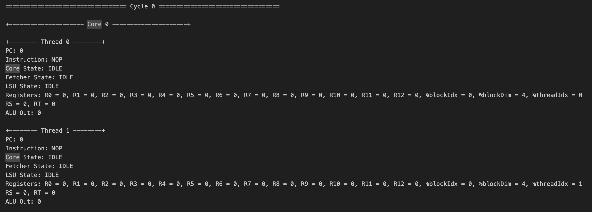

# Mico-gpu

> A minimal, fully-documented GPU implementation in Verilog — built to demystify how GPUs actually work at the hardware level.

Crafted with under 15 files of richly commented Verilog, complete architecture & ISA documentation, working matrix kernels (addition + multiplication), and full simulation support with execution traces.

---

### Table of Contents

- [Overview](#overview)
- [Architecture](#architecture)
  - [GPU](#gpu)
  - [Memory](#memory)
  - [Core](#core)
- [ISA](#isa)
- [Execution](#execution)
  - [Core Execution Flow](#core-execution-flow)
  - [Thread Execution](#thread-execution)
- [Kernels](#kernels)
  - [Matrix Addition](#matrix-addition)
  - [Matrix Multiplication](#matrix-multiplication)
- [Simulation](#simulation)
- [Advanced Functionality](#advanced-functionality)
- [Next Steps](#next-steps)
- [License](#license)

---

# Overview

Want to learn how a CPU works end-to-end — from architecture down to control signals? Plenty of great resources exist for that.

GPUs are a different story.

The GPU market is fiercely competitive. Low-level technical details for modern architectures remain largely proprietary, and while GPU *programming* resources are plentiful, resources explaining GPU *hardware* internals are nearly nonexistent.

Open-source GPU projects like [Miaow](https://github.com/VerticalResearchGroup/miaow) and [VeriGPU](https://github.com/hughperkins/VeriGPU/tree/main) exist, but they target feature completeness — making them complex and hard to approach for learners.

That's exactly why **Mico-gpu** was built.

## What is Mico-gpu?

> [!IMPORTANT]
>
> **Mico-gpu** is a minimal GPU implementation optimized for learning how GPUs work from the ground up.
>
> With the rise of general-purpose GPUs (GPGPUs) and ML accelerators like Google's TPU, Mico-gpu focuses on the **core architectural principles** shared by all modern hardware accelerators — rather than graphics-specific details.

By stripping away production-grade complexity, Mico-gpu lets you focus on the three fundamental pillars of GPU design:

1. **Architecture** — What does a GPU look like structurally? What are its most critical building blocks?
2. **Parallelization** — How is the SIMD programming model physically realized in hardware?
3. **Memory** — How does a GPU work around the constraints of limited memory bandwidth?

Once you have a handle on these fundamentals, the [Advanced Functionality](#advanced-functionality) section covers the most impactful real-world optimizations used in production GPUs.

---

# Architecture

<p float="left">
  
  
</p>

## GPU

Mico-gpu executes a single kernel at a time.

To launch a kernel:

1. Load global program memory with the kernel code.
2. Load data memory with the required input data.
3. Write the thread count into the device control register.
4. Assert the start signal to begin execution.

The GPU is composed of the following units:

1. **Device Control Register**
2. **Dispatcher**
3. **Compute Cores** (configurable count)
4. **Memory Controllers** (data memory & program memory)
5. **Cache**

### Device Control Register

Stores metadata that controls how kernels are executed. In Mico-gpu, this stores a single value: `thread_count` — the total number of threads to launch for the active kernel.

### Dispatcher

After a kernel is launched, the dispatcher manages how threads are distributed across compute cores.

Threads are grouped into **blocks** — sets of threads that can be executed in parallel on a single core. The dispatcher feeds these blocks to available cores and signals kernel completion once all blocks have been processed.

## Memory

Mico-gpu interfaces with external global memory. Data memory and program memory are kept separate for clarity.

### Global Memory

**Data memory:**
- 8-bit addressable (256 rows)
- 8-bit data width (values 0–255 per row)

**Program memory:**
- 8-bit addressable (256 rows)
- 16-bit data width (one instruction per row, per the ISA spec)

### Memory Controllers

Global memory has fixed read/write bandwidth. When the number of simultaneous memory requests from compute cores exceeds what external memory can handle, the memory controllers step in — throttling outgoing requests and routing responses back to the correct resources.

Each controller has a fixed number of channels sized to match global memory bandwidth.

### Cache (WIP)

When multiple cores repeatedly request the same data from global memory, it's wasteful to re-fetch it every time. The cache stores recently fetched data in on-device SRAM, dramatically reducing latency for repeat accesses and freeing up memory bandwidth for new requests.

## Core

Each core contains a set of compute resources sized around a fixed number of threads. In Mico-gpu, each core processes one **block** at a time. For each thread in a block, the core provides a dedicated ALU, LSU, PC, and register file.

### Scheduler

A single scheduler per core manages thread execution.

Mico-gpu's scheduler runs all instructions for a block sequentially and in lock-step — all threads execute the same instruction at the same time. A new block is picked up only after the current one completes.

More advanced schedulers use **pipelining** (streaming multiple instructions through the pipeline simultaneously) and **warp scheduling** (interleaving execution across multiple thread batches) to maximize resource utilization.

The scheduler's central challenge is handling the async latency of load/store operations — memory accesses that can stall execution for many cycles.

### Fetcher

Asynchronously fetches the instruction at the current program counter from program memory. (After the first block executes, most fetches should hit the instruction cache.)

### Decoder

Decodes the fetched instruction into concrete control signals for the execution units.

### Register Files

Every thread has its own dedicated register file — the local workspace for data computations. This is what enables the **SIMD (Single Instruction, Multiple Data)** pattern: every thread runs the same instructions on its own unique data.

Each register file also contains read-only registers holding `%blockIdx`, `%blockDim`, and `%threadIdx`, allowing kernels to operate on different data depending on thread identity.

### ALUs

One dedicated arithmetic-logic unit per thread. Handles: `ADD`, `SUB`, `MUL`, `DIV`.

Also handles the `CMP` instruction, which computes the sign of the difference between two registers and stores the result (negative / zero / positive) into the **NZP register** inside the PC unit.

### LSUs

One dedicated load-store unit per thread for accessing global data memory. Handles `LDR` and `STR` instructions, including async wait cycles while memory controller processes the request.

### PCs

One dedicated program counter per thread, tracking the next instruction to execute.

By default, the PC increments by 1 per instruction. The `BRnzp` instruction checks the NZP register set by a prior `CMP` and conditionally branches to a specified line in program memory — this is how loops and conditionals are implemented.

Mico-gpu assumes all threads converge to the same PC after each instruction (a simplification). Real GPUs handle **branch divergence**, where threads branch to different PCs and must be split into separate execution paths.

---

# ISA


Mico-gpu implements a compact 11-instruction ISA sufficient for proof-of-concept kernels like matrix addition and multiplication.

| Instruction | Description |
|-------------|-------------|
| `BRnzp` | Branch to a target address if the NZP register matches the specified condition |
| `CMP` | Compare two registers; store the result sign in the NZP register |
| `ADD` | Integer addition |
| `SUB` | Integer subtraction |
| `MUL` | Integer multiplication |
| `DIV` | Integer division |
| `LDR` | Load a value from global memory into a register |
| `STR` | Store a register value into global memory |
| `CONST` | Load an immediate constant into a register |
| `RET` | Signal end of execution for the current thread |

Each register is specified with 4 bits → 16 total registers.  
`R0`–`R12` are general-purpose read/write registers.  
The last 3 are read-only special registers: `%blockIdx`, `%blockDim`, `%threadIdx`.

---

# Execution

## Core Execution Flow

Each core steps through the following stages for every instruction:

| Stage | Description |
|-------|-------------|
| `FETCH` | Fetch the next instruction from program memory at the current PC |
| `DECODE` | Decode the instruction into control signals |
| `REQUEST` | Issue a global memory request (for `LDR` / `STR` only) |
| `WAIT` | Wait for the memory response (for `LDR` / `STR` only) |
| `EXECUTE` | Perform the computation |
| `UPDATE` | Write results back to register files and the NZP register |

This sequential control flow is chosen for clarity. In practice, stages can be compressed and **pipelining** can be used to overlap multiple instructions in flight simultaneously.

## Thread Execution


Each thread follows the execution path shown above — closely resembling a classic CPU datapath. The key distinction: `%blockIdx`, `%blockDim`, and `%threadIdx` in the read-only registers enable SIMD behavior across many threads running in parallel.

---

# Kernels

Two proof-of-concept kernels are included to demonstrate SIMD programming and execution. The test suite can fully simulate either kernel, outputting data memory states and a complete cycle-by-cycle execution trace.

## Matrix Addition

Adds two `1×8` matrices element-wise using 8 parallel threads.

Demonstrates: `%blockIdx` / `%blockDim` / `%threadIdx` SIMD addressing, `LDR` / `STR` async memory operations.

`matadd.asm`

```asm
.threads 8
.data 0 1 2 3 4 5 6 7          ; matrix A (1 x 8)
.data 0 1 2 3 4 5 6 7          ; matrix B (1 x 8)

MUL R0, %blockIdx, %blockDim
ADD R0, R0, %threadIdx         ; i = blockIdx * blockDim + threadIdx

CONST R1, #0                   ; baseA (matrix A base address)
CONST R2, #8                   ; baseB (matrix B base address)
CONST R3, #16                  ; baseC (matrix C base address)

ADD R4, R1, R0                 ; addr(A[i]) = baseA + i
LDR R4, R4                     ; load A[i] from global memory

ADD R5, R2, R0                 ; addr(B[i]) = baseB + i
LDR R5, R5                     ; load B[i] from global memory

ADD R6, R4, R5                 ; C[i] = A[i] + B[i]

ADD R7, R3, R0                 ; addr(C[i]) = baseC + i
STR R7, R6                     ; store C[i] in global memory

RET                            ; end of kernel
```

## Matrix Multiplication

Multiplies two `2×2` matrices. Each of the 4 threads computes one output element by calculating the dot product of the corresponding row and column. Uses `CMP` + `BRnzp` to demonstrate branching (all branches converge, so this works on Mico-gpu's current scheduler).

`matmul.asm`

```asm
.threads 4
.data 1 2 3 4                  ; matrix A (2 x 2)
.data 1 2 3 4                  ; matrix B (2 x 2)

MUL R0, %blockIdx, %blockDim
ADD R0, R0, %threadIdx         ; i = blockIdx * blockDim + threadIdx

CONST R1, #1                   ; increment
CONST R2, #2                   ; N (matrix inner dimension)
CONST R3, #0                   ; baseA (matrix A base address)
CONST R4, #4                   ; baseB (matrix B base address)
CONST R5, #8                   ; baseC (matrix C base address)

DIV R6, R0, R2                 ; row = i // N
MUL R7, R6, R2
SUB R7, R0, R7                 ; col = i % N

CONST R8, #0                   ; acc = 0
CONST R9, #0                   ; k = 0

LOOP:
  MUL R10, R6, R2
  ADD R10, R10, R9
  ADD R10, R10, R3             ; addr(A[i]) = row * N + k + baseA
  LDR R10, R10                 ; load A[i] from global memory

  MUL R11, R9, R2
  ADD R11, R11, R7
  ADD R11, R11, R4             ; addr(B[i]) = k * N + col + baseB
  LDR R11, R11                 ; load B[i] from global memory

  MUL R12, R10, R11
  ADD R8, R8, R12              ; acc = acc + A[i] * B[i]

  ADD R9, R9, R1               ; increment k

  CMP R9, R2
  BRn LOOP                    ; loop while k < N

ADD R9, R5, R0                 ; addr(C[i]) = baseC + i
STR R9, R8                     ; store C[i] in global memory

RET                            ; end of kernel
```

---

# Simulation

Mico-gpu includes a full simulation setup for both kernels.

**Prerequisites:**

- [Icarus Verilog](https://steveicarus.github.io/iverilog/usage/installation.html): `brew install icarus-verilog`
- [cocotb](https://docs.cocotb.org/en/stable/install.html): `pip3 install cocotb`
- [sv2v](https://github.com/zachjs/sv2v/releases): download the latest release, unzip, and add the binary to `$PATH`

**Setup:**

```bash
mkdir build
```

**Run simulations:**

```bash
make test_matadd    # simulate matrix addition kernel
make test_matmul    # simulate matrix multiplication kernel
```

Simulation outputs a log file in `test/logs` containing:
- Initial data memory state
- Complete cycle-by-cycle execution trace
- Final data memory state

The initial state shows your input matrices; the final state shows the computed result matrix.



> [!TIP]
> Running into issues getting the simulation up? Feel free to open a GitHub issue — happy to help get you unblocked.

---

# Advanced Functionality

Mico-gpu intentionally omits many real-world GPU features to keep the design learnable. Here's a summary of the most impactful ones:

### Multi-Layered Cache & Shared Memory

Production GPUs use multiple cache levels — some private to individual cores — to keep frequently accessed data close to the compute units and minimize global memory latency. Mico-gpu implements a single cache layer.

**Shared memory** is a further optimization that lets threads within the same block share a fast, on-chip memory region to exchange intermediate results.

### Memory Coalescing

When many threads access sequential memory addresses simultaneously, their individual requests can be merged into a single, larger transaction — dramatically reducing memory access overhead. Mico-gpu processes each request independently.

### Pipelining

Mico-gpu waits for each instruction to fully complete before issuing the next. Real GPUs use **instruction pipelining** to overlap multiple in-flight instructions, keeping execution units busy even while waiting on memory.

### Warp Scheduling

Blocks can be further divided into **warps** — smaller thread batches. Multiple warps can be in-flight on a single core, with the scheduler interleaving their execution to hide memory latency. This is analogous to pipelining but at the thread-batch level.

### Branch Divergence

Mico-gpu assumes all threads in a block always converge to the same PC. Real GPUs handle **branch divergence** — when threads branch to different PCs based on their data, they must be split into independent execution paths and eventually reconverged.

### Synchronization & Barriers

**Barriers** allow threads within a block to synchronize — each thread waits until all others have reached the barrier point before proceeding. Essential when threads need to share intermediate results via shared memory.

---

# Next Steps

Planned improvements — contributions welcome:

- [ ] Add an instruction cache
- [ ] Build an adapter for Tiny Tapeout 7
- [ ] Implement basic branch divergence handling
- [ ] Implement basic memory coalescing
- [ ] Implement basic pipelining
- [ ] Optimize control flow and register usage to improve cycle time
- [ ] Write a basic graphics kernel or add simple graphics hardware

**Feel free to open a PR with any improvements you'd like to contribute! 😄**

---

# License

Copyright © 2026 **Aryan Gahlot**. All rights reserved.

This project is provided for educational purposes. You are free to use, study, and modify the source code for personal and non-commercial use, provided that appropriate credit is given to the original author.
